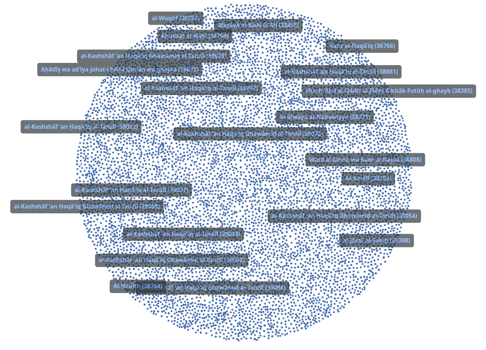

## Expressions

A network of Expressions on their own, as we can see convery very little information beyond the size of the database.

## Expressions and Manuscripts

When we view expressions along with the manuscripts they are from, a different picture emerges.

## Expressions, Manuscripts and Institutions

And when we include the holding institutions of these manuscripts then the manuscripts that are housed in the same institutions cluster together, giving another perspective.

